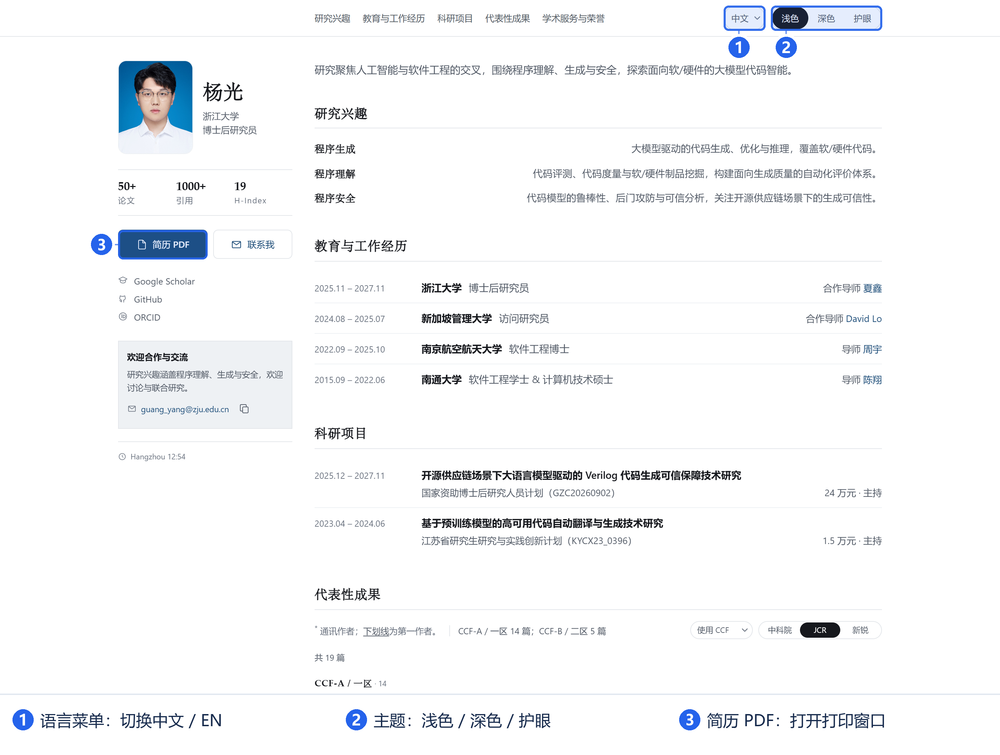
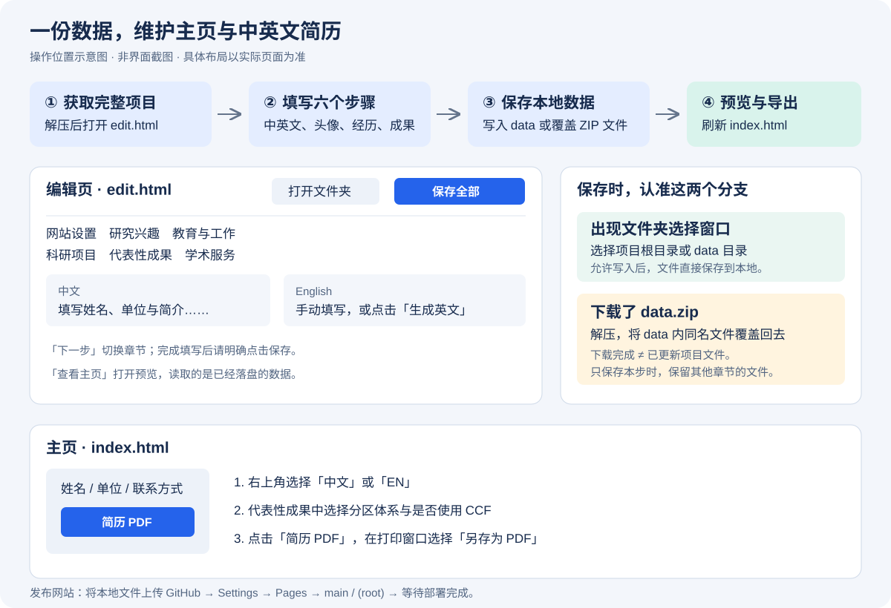
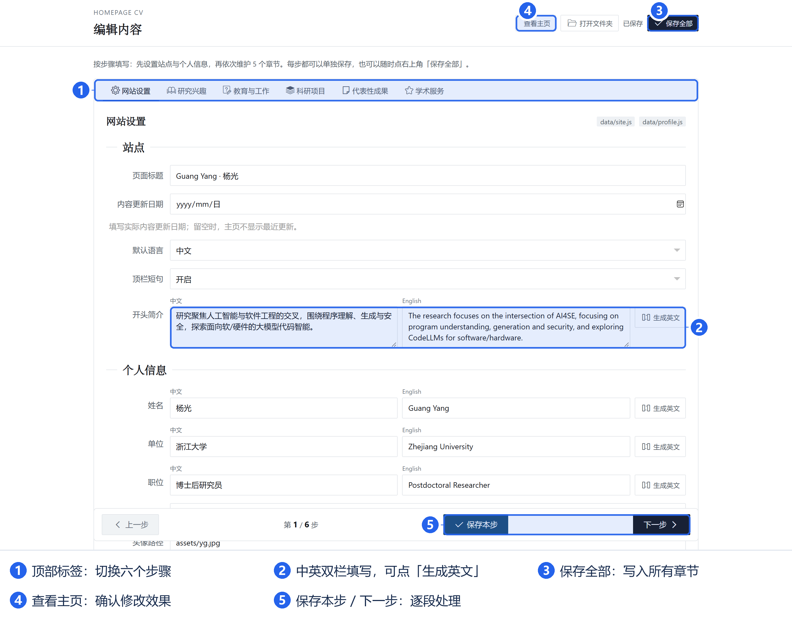
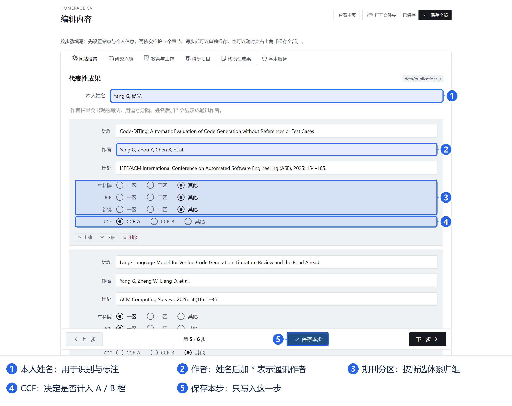
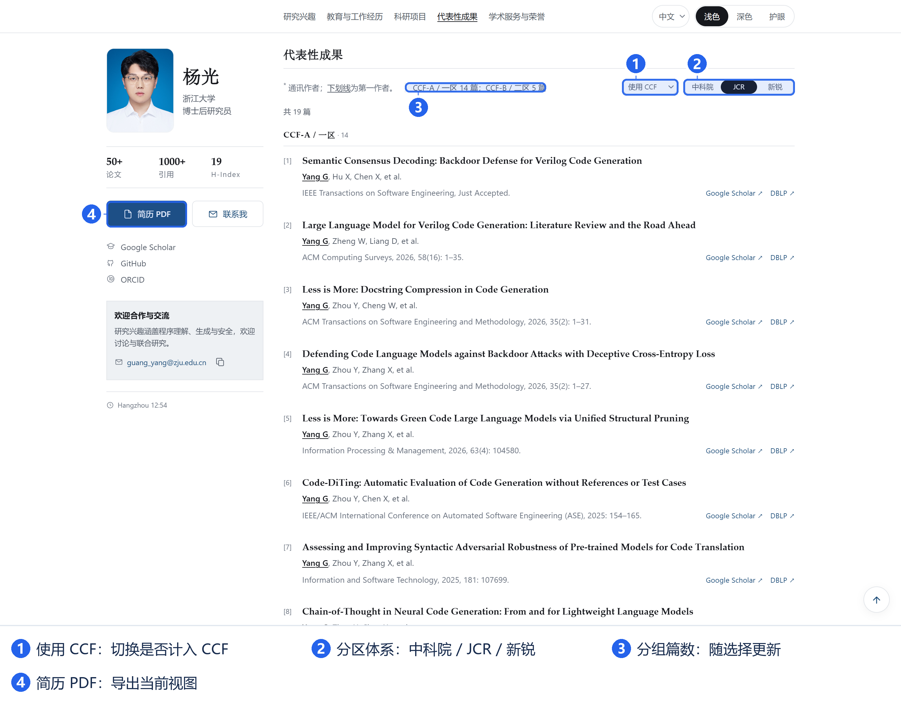

# Homepage as CV: 主页即简历

个人主页与中英文简历共用同一套 `data/` 数据。浏览器打开 `edit.html` 维护内容，打开 `index.html` 浏览主页；选定语言与分区后，点击「简历 PDF」（英文界面为「CV · PDF」），由浏览器打印窗口导出 PDF。纯静态实现，无 Node、Rust 等环境依赖。

*图 1：主页界面（示例数据，Edge 1440 × 1000）。① 语言切换（中文 / EN） ② 主题切换（浅色 / 深色 / 护眼，仅影响屏幕显示） ③ 导出 PDF 简历。*

## 设计动机

学术材料维护常见四类冗余工作：

- **多源不同步**：主页、中文简历、英文简历独立维护，单次更新需改三处。
- **分区口径差异**：不同院校采用中科院、JCR 或新锐分区，对 CCF 认定亦不一致；按校重排分组与统计易出错。
- **手工排序繁琐**：经历与项目需按时间倒序，同档论文需按作者位次、年份及录用状态排序。
- **构建环境依赖**：基于 Node、Jekyll、Hugo 的模板跨设备维护时需重复配置环境。

本项目将主页与简历收敛为单一数据源：

- 中英文同源存储，于 `edit.html` 集中编辑，支持由中文生成英文初稿。
- 主页实时切换语言、分区体系（中科院 / JCR / 新锐）及 CCF 开关，导出 PDF 与当前视图一致。
- 条目按既定规则自动排序：
  - **教育与工作、科研项目**：按起始时间倒序；无起始时间者置于末尾。
  - **代表性成果**：同档内按作者位次（本人第一作者 → 其他位次 → 未匹配本人）及出版年份倒序；无年份条目（如 `Just Accepted`）置于同类之首，含 `Major Revision` 条目置于该档末尾。
- 纯静态文件，本地直接打开，推送至 GitHub Pages 即可发布。

## 目录

- [快速使用](#快速使用)
- [分步填写说明](#分步填写说明)
- [数据保存与备份](#数据保存与备份)
- [语言分区切换与-pdf-导出](#语言分区切换与-pdf-导出)
- [部署至-github-pages](#部署至-github-pages)
- [常见问题](#常见问题)
- [文件结构与直接修改](#文件结构与直接修改)

## 快速使用

环境要求：现代桌面浏览器（建议 Chrome 或 Edge）。若浏览器支持本地目录读写且已授权，保存时直接写回 `data/*.js`；否则自动导出 `data.zip`，解压覆盖即可。

*图 2：编辑、保存、预览与导出流程示意。*

1. **获取代码。** 克隆仓库，或下载 ZIP 并解压至本地目录（勿在压缩包内直接打开 HTML）。
2. **核对目录。** 确保 `edit.html`、`index.html`、`data/`、`assets/`、`layui/` 位于同一级目录。
3. **编辑数据。** 浏览器打开 `edit.html`，修改内容后点击「保存全部」或「保存本步」，按提示写回本地目录或解压覆盖 `data.zip`。
4. **预览核验。** 打开或刷新 `index.html` 查看已落盘的数据（编辑页的未保存修改不会反映到主页）。

## 分步填写说明

编辑器共 **6 步**，「个人信息」位于第 1 步「网站设置」。可通过顶部标签或底部「上一步 / 下一步」切换；切换步骤不会自动写盘，需显式点击「保存本步」或「保存全部」。

### 1. 网站设置与个人信息

*图 3：编辑页第 1 步。① 步骤导航 ② 中英双栏与「生成英文」 ③ 「保存全部」 ④ 「查看主页」 ⑤ 「保存本步 / 下一步」。*

| 字段 | 说明 | 备注 |
| --- | --- | --- |
| 页面标题 | 浏览器标签页标题 | 如 `张三 · San Zhang` |
| 内容更新日期 | 内容更新日期 | 留空则页脚不显示更新日期 |
| 默认语言 | 初始语言（中文 / English） | 主页可随时切换 |
| 顶栏短句 | 顶栏短句开关 | 开启 / 关闭 |
| 开头简介 | 个人研究概述（中 / 英） | 概述研究方向与主题 |
| 姓名、单位、职位 | 基本身份信息（中 / 英） | 英文名建议与论文署名一致 |
| 邮箱 | 公开联系邮箱 | 如 `name@example.com` |
| 头像路径 | 相对仓库根目录的图片路径 | 如 `assets/photo.jpg` |
| 指标、链接 | 学术指标数值与外部主页链接 | 链接需包含 `https://` |
| 合作卡片 | 合作说明标题与正文（中 / 英） | 显示于左侧栏底部 |
| 所在城市、时区 | 所在地与 IANA 时区 | 如 `Hangzhou`、`Asia/Shanghai` |

**头像更换：** 将图片放入 `assets/`，在「头像路径」填写相对路径（区分大小写，如 `assets/photo.jpg`）。该字段仅记录路径，部署时需一并提交图片文件。

**中英双栏：** 可分别填写，或填好中文后点击「生成英文」调用在线翻译接口（需联网；姓名、机构与专业术语请人工复核）。本地编辑与预览不依赖该接口。

### 2. 研究兴趣

逐条填写研究方向的「条目」名称与「说明」正文（中 / 英）。通过「新增条目」添加，冗余示例直接删除。

### 3. 教育与工作

点击「新增经历」，填写起止时间、单位、职位及导师信息。

- 时间格式建议为 `2022.09 – 2025.10` 或 `2025.11 – 至今`，保留明确年月以便排序。
- 导师称谓、姓名与主页均留空时，主页隐藏导师栏。

### 4. 科研项目

点击「新增项目」，填写起止时间、项目名称、资助来源、经费金额（中 / 英），并选择角色（主持 / 参与）。

### 5. 代表性成果

先填写「本人姓名」，再逐篇录入论文。该配置决定作者高亮、排序位次及各分区体系下的归组结果。

*图 4：编辑页第 5 步。① 本人姓名别名 ② 作者列表（`*` 表通讯作者） ③ 期刊分区 ④ CCF 等级 ⑤ 「保存本步」。*

| 字段 | 规范 |
| --- | --- |
| 本人姓名 | 本人可能出现的全部署名形式，英文逗号分隔（如 `Zhang S, 张三`），勿含 `*` |
| 标题 | 论文完整题目 |
| 作者 | 按原顺序填写，英文逗号分隔；通讯作者于姓名后加 `*`（如 `Zhang S, Li M*`） |
| 出处 | 期刊/会议名称、年份、卷期页码或录用状态（如 `Just Accepted`、`Major Revision`） |
| 中科院 / JCR / 新锐 | 选择「一区」「二区」或「其他」 |
| CCF | 选择「CCF-A」「CCF-B」或「其他」 |

分区信息需自行核对录入，系统仅展示一区、二区及 CCF-A/B 条目，「其他」不单独成组。归组逻辑如下：

| 条目分区配置 | 开启「使用 CCF」 | 关闭「使用 CCF」 |
| --- | --- | --- |
| 当前体系为一/二区，且有 CCF-A/B | 取二者较高档次（如二区 + CCF-A 归入第一档） | 仅按当前体系分区 |
| 当前体系为一/二区，无 CCF-A/B | 按当前体系分区 | 按当前体系分区 |
| 三个体系均为「其他」，仅有 CCF-A/B | 按 CCF 等级分组 | 不展示 |
| 其他体系有分区，但当前体系为「其他」或未填 | 不展示（含已填 CCF-A/B 的情形） | 不展示 |
| 无有效分区且无 CCF-A/B | 不展示 | 不展示 |

同档排序优先级：本人第一作者（姓名带下划线）→ 本人其他位次 → 未匹配本人；同类内按出处中的四位年份倒序；未检出年份者（如 `Just Accepted`）置于同类之首，含 `Major Revision` 者置于该档末尾。

### 6. 学术服务

按分栏维护学术兼职、审稿服务、荣誉奖项等，支持修改列标题与各条目的中英文内容。完成后点击「保存全部」。

## 数据保存与备份

### 方式一：直接写回本地目录

浏览器支持本地目录读写时：

1. 点击「保存全部」（写入全部数据文件）或「保存本步」（仅写入当前步骤对应文件；其中第 1 步同时写入 `data/site.js` 与 `data/profile.js`）。
2. 首次保存时，在弹窗中选择项目根目录或其下的 `data/` 目录，并授予写入权限。
3. 显示「已保存」后刷新 `index.html` 核验。

顶部「打开文件夹」用于从指定目录重新载入 `data/*.js` 并获取读写权限，会覆盖编辑器中的未保存修改。

### 方式二：导出 ZIP 手动覆盖

浏览器不支持直接写回或授权取消/失败时：

1. 保存操作触发 `data.zip` 下载。
2. 解压后将其中 `data/` 下的 `.js` 文件复制至项目 `data/` 目录，覆盖同名文件（若仅执行「保存本步」，压缩包只含该步文件，切勿先清空原 `data/` 目录，亦勿嵌套为 `data/data/`）。
3. 刷新 `index.html` 核验。

## 语言、分区切换与 PDF 导出

*图 5：代表性成果栏与导出入口。① CCF 开关 ② 分区体系切换 ③ 各档篇数统计 ④ 「简历 PDF」按钮。*

1. 打开或刷新 `index.html`，于右上角选择语言（中文 / EN）。
2. 在「代表性成果」栏选择分区体系（中科院 / JCR / 新锐）及是否计入 CCF，核对篇数统计与排序。
3. 点击左侧「简历 PDF」（英文为「CV · PDF」），在打印窗口将目标设为「另存为 PDF」。
4. 建议使用 A4 纵向排版，按预览调整边距与缩放，并关闭浏览器页眉页脚。打印时文档标题自动设为 `姓名 - CV - 分区`（关闭 CCF 时附加标记），作为默认文件名。

如需中英文或不同分区口径的多份简历，切换对应选项后分别导出即可。

## 部署至 GitHub Pages

1. 新建或 Fork 仓库，将完整项目推送至 `main` 分支，确保仓库根目录直接包含 `index.html`、`edit.html`、`data/`、`assets/` 与 `layui/`。
2. 进入仓库「Settings」→「Pages」，将「Build and deployment」下的「Source」设为「Deploy from a branch」，分支选 `main`、目录选 `/ (root)` 并保存（详见 [GitHub Pages 官方文档](https://docs.github.com/en/pages/getting-started-with-github-pages/configuring-a-publishing-source-for-your-github-pages-site)）。
3. 部署完成后访问对应地址：仓库名为 `<用户名>.github.io` 时为 `https://<用户名>.github.io/`，其余仓库名为 `https://<用户名>.github.io/<仓库名>/`。

**后续更新：** `edit.html` 仅修改本地文件，不会自动同步至远端。本地核验无误后，需将更新后的 `data/` 与新增图片提交并推送至发布分支。发布前请替换全部示例个人信息，并按需修改 `index.html` 头部的 `<meta>` 描述与作者字段。

## 常见问题

| 现象 | 处理方式 |
| --- | --- |
| 页面空白或样式缺失 | 确认已解压完整目录，`layui/`、`assets/`、`data/` 与 HTML 同级 |
| 提示未读到 `data/*.js` 或某文件读取失败 | 检查目录结构或点击「打开文件夹」重新载入；读取失败的文件会被禁止写回以保护原文件，需先修复语法后重载 |
| 保存后主页未更新 | 刷新 `index.html`；若采用 ZIP 方式，确认已解压覆盖至当前项目的 `data/` 目录 |
| 头像无法显示 | 核对图片是否已放入 `assets/`、文件名大小写是否一致，以及线上仓库是否已提交该文件 |
| 「生成英文」失败 | 检查网络连接，或直接手动填写英文内容 |
| 切换分区后部分论文未显示 | 对照上文归组表，核查该论文在当前体系下是否为「其他」/未填，以及 CCF 开关状态 |
| 本人未高亮或同档排序异常 | 核查「本人姓名」是否包含该篇署名形式、作者是否以英文逗号分隔、出处年份及 `Major Revision` 标记 |
| 打开主页时的语言与默认语言不一致 | 浏览器 `localStorage` 记录了上次选择，在右上角语言菜单切换即可 |
| 线上页面未更新或返回 404 | 确认已推送至发布分支且 Actions 部署成功；非个人同名仓库需在 URL 后附加 `/<仓库名>/` |

## 文件结构与直接修改

| 路径 | 说明 |
| --- | --- |
| `index.html` | 主页与打印视图入口（含顶栏导航与页面 `<meta>` 信息） |
| `edit.html` | 本地六步可视化编辑器 |
| `data/site.js` | 站点标题、默认语言、更新日期、简介与章节注册 |
| `data/profile.js` | 个人信息、头像路径、学术指标、外部链接与合作卡片 |
| `data/research.js` | 研究兴趣 |
| `data/experience.js` | 教育与工作经历 |
| `data/projects.js` | 科研项目 |
| `data/publications.js` | 论文列表、本人署名、分区体系与默认展示配置 |
| `data/service.js` | 学术服务、荣誉与竞赛分栏数据 |
| `assets/style.css`、`assets/script.js` | 主页样式（含打印样式）与渲染、排序、交互逻辑 |
| `assets/edit.css`、`assets/edit.js` | 编辑器样式与表单绑定、翻译、写盘/打包逻辑 |
| `layui/` | 前端组件库 |
| `docs/images/` | README 流程图（`.svg`）与带标注的界面截图（`.png`） |

`data/*.js` 通过 `window.HOMEPAGE.files[...]` 注册数据对象，并非裸 JSON。直接编辑源码时需保留外层包装结构与合法 JavaScript 语法；编辑器未暴露的配置项（如指标标签名称、章节顺序）可直接在此类文件中修改。

## 许可

[MIT](LICENSE)。仓库中的论文、经历与头像仅作示例，使用时请替换为你自己的信息。